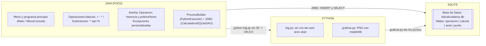

# Proyecto Integrado: La Calculadora — Java, Python y SQLite

| Dato | Detalle |
| :--- | :--- |
| **Institución** | Escuela Superior de Empresa, Ingeniería y Tecnología (ESEIT) |
| **Docente** | Luis Fernando Vera Jaimes |
| **Período** | 2026-2 |
| **Asignaturas** | Bases de Datos y Programación Orientada a Objetos 2 (POO2) |
| **Sistema Operativo** | Windows |

---

## Diagramas del Proyecto ([`diagramas/`](./diagramas/README.md))

| # | Documento | Descripción |
| :-: | :--- | :--- |
| **00** | [Galería de Diagramas (`diagramas/README.md`)](./diagramas/README.md) | Vista general con todos los diagramas del proyecto. |
| **01** | [Flujograma 1: La Operación Completa](./diagramas/01_Flujograma_1_Operacion_Completa.md) | Flujograma de una operación completa y tabla de trazabilidad. |
| **02** | [Flujograma 2: Serie de Puntos y su Gráfica](./diagramas/02_Flujograma_2_Serie_y_Grafica.md) | Flujograma de generación de serie y gráfica desde SQLite. |
| **03** | [Diagrama E-R y Modelo Relacional 3FN](./diagramas/03_Diagrama_ER_y_Modelo_Relacional_3FN.md) | Requisitos R1–R9, diagrama Entidad-Relación y normalización 3FN. |
| **04** | [Diagrama de Clases UML (POO2)](./diagramas/04_Diagrama_Clases_UML_POO2.md) | Diagrama de clases con atributos, métodos y relaciones. |
| **05** | [Arquitectura y Gráficas Generadas](./diagramas/05_Arquitectura_y_Graficas_Matplotlib.md) | Esquema de comunicación entre capas y gráficas en PNG. |

---

## Arquitectura del Sistema



---

## Estructura del Repositorio

```text
calculadora/
├── diagramas/                             # Diagramas y gráficas del proyecto
│   ├── README.md
│   ├── 01_Flujograma_1_Operacion_Completa.md
│   ├── 02_Flujograma_2_Serie_y_Grafica.md
│   ├── 03_Diagrama_ER_y_Modelo_Relacional_3FN.md
│   ├── 04_Diagrama_Clases_UML_POO2.md
│   ├── 05_Arquitectura_y_Graficas_Matplotlib.md
│   └── img/
├── docs/                                  # Documentación y guía de sustentación
│   ├── Hito1_Diseno_Completo.md
│   └── Guia_Sustentacion_LineaxLinea.md
├── bd/                                    # Scripts SQL y base de datos SQLite
│   ├── create_schema.sql
│   ├── seed.sql
│   ├── pruebas.sql
│   ├── consultas.sql
│   ├── sql.py
│   └── calculadora.db
├── python/                                # Scripts de cálculo y graficación
│   ├── trig.py
│   └── graficar.py
├── lib/                                   # Controlador JDBC sqlite-jdbc
└── src/
    └── calculadora/                       # Código fuente en Java
```

---

## Ejecución en Windows

### 1. Base de Datos SQLite
```powershell
python bd/sql.py calculadora.db -c "SELECT 1;"
python bd/sql.py --init
```

### 2. Scripts en Python
```powershell
python python/trig.py sin 180 --modo grados
python python/trig.py tan 90 --modo grados
python python/trig.py asin 2 --modo grados
python python/trig.py serie sin -360 360 15 --modo grados
python python/graficar.py bd/calculadora.db 1 diagramas/img/serie_tan_demo.png
```

### 3. Compilación y Ejecución en Java
```powershell
javac -encoding UTF-8 -sourcepath src -cp "lib\*" -d out src\calculadora\Main.java
java "-Dfile.encoding=UTF-8" -cp "out;lib\*" calculadora.Main
```
