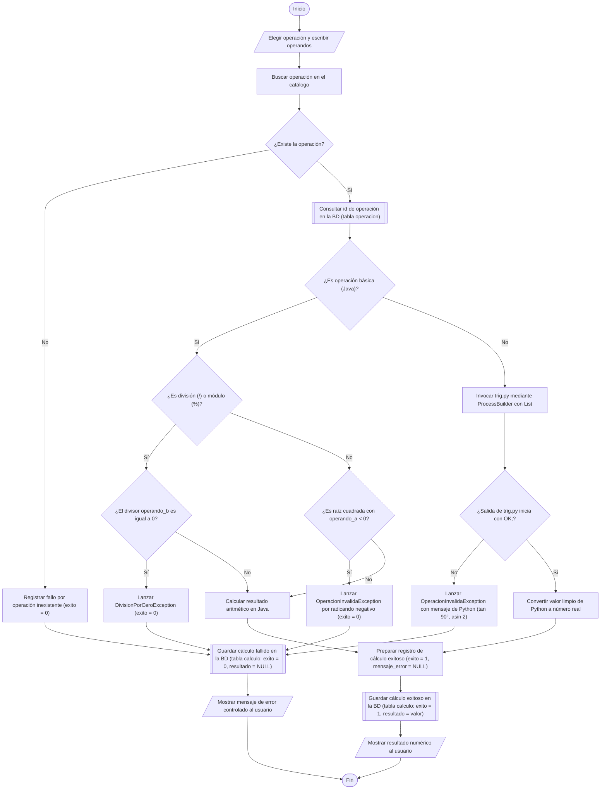

# 01. Flujograma 1: La Operación Completa

[Volver a la Galería de Diagramas](./README.md)

---

## Reglas del Flujograma Verificadas (Sección 4 del Enunciado Maestro)
- **Óvalo (`([...])`):** Un solo `Inicio` y un `Fin` donde convergen todos los caminos.
- **Paralelogramo (`[/"..."/]`):** Entrada de operandos y salida en pantalla.
- **Rectángulo (`["..."]`):** Cada caja de proceso empieza con un verbo y ejecuta una sola acción.
- **Rombo (`{"¿...?"}`):** Cada decisión tiene exactamente dos salidas rotuladas **`Sí`** y **`No`**.
- **Rectángulo con barras laterales (`[["..."]]`):** Operaciones de lectura/escritura sobre la base de datos `bd/calculadora.db`.

---

## Diagrama Normativo

---

## Conexión Flujograma 1 $\rightarrow$ Diagrama de Clases $\rightarrow$ Base de Datos

| Caja del Flujograma 1 | Método Candidato en el Diagrama de Clases (POO2) | Tabla y Columnas en SQLite (`bd/calculadora.db`) |
| :--- | :--- | :--- |
| Buscar operación en el catálogo | `MotorCalculadora.obtenerOperacion(simboloONombre: String): Operacion` | `operacion (simbolo, nombre)` |
| Consultar `id` de operación en la BD | `CalculadoraSQLiteDAO.obtenerIdOperacionPorSimbolo(simbolo: String): int` | `operacion (id)` |
| Calcular resultado aritmético en Java | `Operacion.ejecutar(operandos: double...): double` `OperacionBinaria.calcularBinario(a: double, b: double): double` `OperacionUnaria.calcularUnario(a: double): double` | *(En memoria Java)* |
| Invocar `trig.py` mediante `ProcessBuilder` | `OperacionPython.calcularUnario(operandoA: double): double` `PythonExecutor.evaluarFuncionPuntual(fn: String, val: double, modo: String): double` | *(Contrato CLI `OK;<res>` / `ERROR;<msg>`)* |
| Guardar cálculo exitoso o fallido en la BD | `MotorCalculadora.ejecutarYPersistir(simbolo: String, modo: String, operandos: double...): double` `CalculadoraSQLiteDAO.guardarCalculo(registro: RegistroCalculo): int` | `calculo (operacion_id, operando_a, operando_b, modo_angulo, resultado, exito, mensaje_error, creado_en)` |
