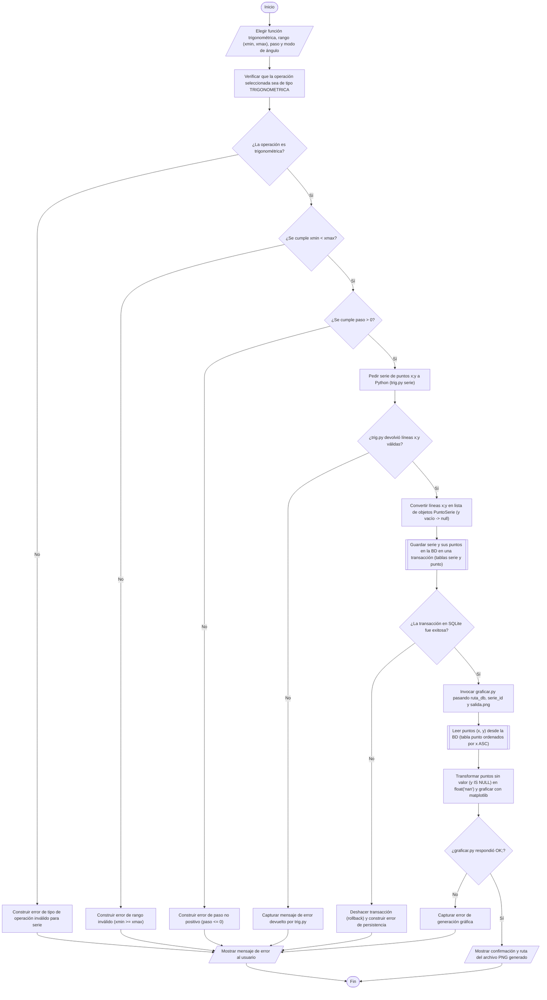

# 02. Flujograma 2: La Serie de Puntos y su Gráfica

[Volver a la Galería de Diagramas](./README.md)

---

## Diagrama Normativo

---

## Conexión Flujograma 2 $\rightarrow$ Diagrama de Clases $\rightarrow$ Base de Datos

| Caja del Flujograma 2 | Método Candidato en el Diagrama de Clases (POO2 / Python) | Tabla y Columnas en SQLite (`bd/calculadora.db`) |
| :--- | :--- | :--- |
| Validar `xmin < xmax`, `paso > 0` y tipo `TRIGONOMETRICA` | `MotorCalculadora.generarPersistirYGraficarSerie(...): String` | `serie (CHECK (x_min < x_max), CHECK (paso > 0))` |
| Pedir serie de puntos `x;y` a Python | `PythonExecutor.generarSeriePuntos(fn: String, xmin: double, xmax: double, paso: double, modo: String): List<PuntoSerie>` | *(Contrato CLI `x;y` con `y` vacío en asíntotas)* |
| Guardar serie y sus puntos en la BD (incluidos `y = NULL`) | `CalculadoraSQLiteDAO.guardarSerieYPuntos(nombre: String, operacionId: int, xMin: double, xMax: double, paso: double, modo: String, puntos: List<PuntoSerie>): int` | `serie (id, nombre, operacion_id, x_min, x_max, paso, modo_angulo, creado_en)` `punto (id, serie_id, x, y)` |
| Leer puntos `(x, y)` de la BD y generar PNG | `PythonExecutor.graficarSerieDesdeSQLite(rutaDb: Path, serieId: int, rutaSalidaPng: Path): String` `graficar.py -> graficar_serie(...)` | `serie (SELECT)` y `punto (SELECT x, y WHERE serie_id = ? ORDER BY x ASC)` |
