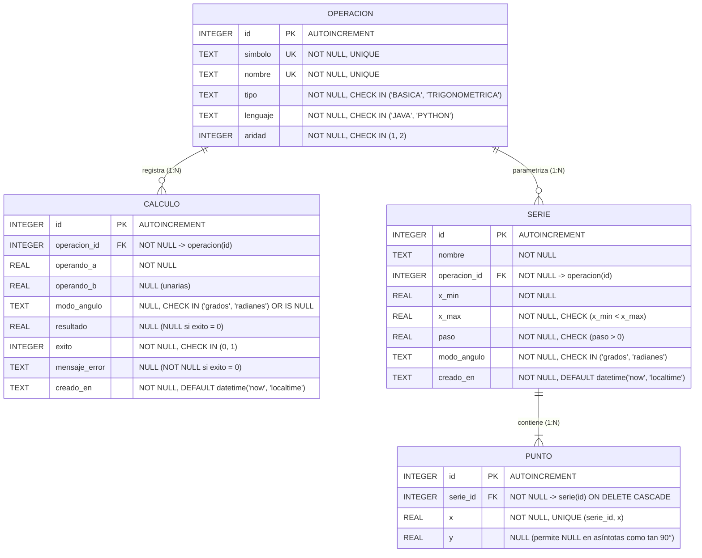

# 03. Diagrama Entidad-Relación, Requisitos R1–R9 y Modelo Relacional (3FN)

[Volver a la Galería de Diagramas](./README.md)

---

## 1. Requisitos de la Base de Datos (Sección 6 del Enunciado Maestro) $\rightarrow$ Entidades y Restricciones

| # | Tema (Sección 6) | Requisito del Enunciado Maestro | Entidad / Tabla | Restricción / Mecanismo Implementado en SQLite |
| :-: | :--- | :--- | :--- | :--- |
| **R1** | **Catálogo** | El sistema conoce las operaciones disponibles: símbolo, nombre, tipo (básica o trigonométrica), lenguaje de implementación (Java o Python) y cuántos operandos recibe. | `operacion` | Columnas `simbolo UNIQUE NOT NULL`, `nombre UNIQUE NOT NULL`, `tipo CHECK IN ('BASICA', 'TRIGONOMETRICA')`, `lenguaje CHECK IN ('JAVA', 'PYTHON')`, `aridad CHECK IN (1, 2)` y `chk_operacion_coherencia_lenguaje`. |
| **R2** | **Historial** | Cada cálculo queda guardado: qué operación, operandos, modo de ángulo (si aplica), resultado y momento. | `calculo` | Columnas `operacion_id FK`, `operando_a NOT NULL`, `operando_b NULL`, `modo_angulo NULL`, `resultado NULL`, `creado_en NOT NULL DEFAULT (datetime('now', 'localtime'))`. |
| **R3** | **Fallos** | Los cálculos que fallan (división por cero, `tan 90°`, `asin 2`) también se guardan, con su mensaje de error y sin resultado. | `calculo` | Cuando `exito = 0`, `chk_calculo_coherencia_exito` exige `resultado IS NULL AND mensaje_error IS NOT NULL AND length(trim(mensaje_error)) > 0`. |
| **R4** | **Modo de ángulo** | Las funciones trigonométricas trabajan en grados o en radianes; las operaciones básicas no llevan modo. | `calculo` y `serie` | En `calculo`: `CHECK (modo_angulo IN ('grados', 'radianes') OR modo_angulo IS NULL)` (`NULL` en básicas). En `serie`: `modo_angulo TEXT NOT NULL CHECK IN ('grados', 'radianes')`. |
| **R5** | **Series** | Se pueden generar series de puntos `(x, y)` de una función en un rango y con un paso, por ejemplo `sin(x)` de `-360°` a `360°` cada `15°`. | `serie` y `punto` | `serie` almacena `(nombre, operacion_id, x_min, x_max, paso, modo_angulo)` con `CHECK (x_min < x_max)` y `CHECK (paso > 0)`. |
| **R6** | **Puntos sin valor** | Hay puntos donde la función no existe (`tan 90°`): la serie debe poder representarlo. | `punto` | En `punto`, la columna `y REAL NULL` admite `NULL`; `graficar.py` convierte `None` en `float('nan')` dejando el hueco en la curva. |
| **R7** | **Consultas** | El historial se consulta por operación, por éxito o fallo y en orden cronológico. | `v_historial_calculos` e Índices | Vista `v_historial_calculos` + índices `idx_calculo_operacion`, `idx_calculo_exito`, `idx_calculo_creado_en` en [consultas.sql](../bd/consultas.sql). |
| **R8** | **Integridad** | La base rechaza datos incoherentes: tipos inválidos, cálculos de operaciones inexistentes, éxito sin resultado, etc. | Las 4 tablas | `PRAGMA foreign_keys = ON;` + `FOREIGN KEY`, `CHECK`, `UNIQUE` y `NOT NULL` verificados en [pruebas.sql](../bd/pruebas.sql). |
| **R9** | **Extensibilidad** | Agregar una operación nueva (potencia, raíz o módulo) no debe obligar a cambiar la estructura de las tablas. | `operacion` | Normalización en 3FN: agregar `^`, `sqrt`, `%` en la Clase 5 es un `INSERT INTO operacion` en [seed.sql](../bd/seed.sql), jamás un `ALTER TABLE`. |

---

## 2. Diagrama Entidad-Relación (`erDiagram`)

---

## 3. Justificación de Tercera Forma Normal (3FN)

1. **Primera Forma Normal (1FN — Atomicidad):**
   - Ninguna columna almacena listas ni textos compuestos: los operandos van en `operando_a` y `operando_b`, y los pares $(x, y)$ de una serie no se guardan como una cadena en `serie`, sino como filas atómicas individuales en `punto`.
2. **Segunda Forma Normal (2FN — Dependencia Funcional Completa):**
   - Los datos de cabecera de una serie (`nombre`, `operacion_id`, `x_min`, `x_max`, `paso`, `modo_angulo`) dependen únicamente de `serie.id`, mientras que la ordenada `y` depende de la clave compuesta `(serie_id, x)` en `punto`. Separar `serie` y `punto` elimina toda dependencia parcial.
3. **Tercera Forma Normal (3FN — Sin Dependencias Transitivas):**
   - `simbolo`, `nombre`, `tipo`, `lenguaje` y `aridad` dependen únicamente de `operacion.id`. Almacenar solo `operacion_id` en `calculo` y en `serie` elimina la dependencia transitiva $\text{calculo.id} \rightarrow \text{operacion\_id} \rightarrow (\text{simbolo}, \text{nombre}, \text{tipo}, \text{lenguaje}, \text{aridad})$.
   - **Defensa del Requisito R9:** Como las operaciones son filas en `operacion` y no columnas fijas en `calculo`, agregar potencia (`^`), raíz cuadrada (`sqrt`) y módulo (`%`) se realiza con `INSERT INTO operacion` sin tocar el DDL de ninguna tabla.
