# 04. Diagrama de Clases UML Completo (POO2)

[Volver a la Galería de Diagramas](./README.md)

---

## Principios Orientados a Objetos Aplicados
1. **Interfaz común (`Operacion`):** Contrato uniforme `ejecutar(operandos: double...): double` y metadatos sincronizados con la tabla `operacion`.
2. **Herencia y Método Plantilla (`OperacionAbstracta`, `OperacionBinaria`, `OperacionUnaria`, `OperacionPython`):** Factoriza la validación de aridad/finitud y especializa las operaciones unarias, binarias y las delegadas a Python.
3. **Polimorfismo y Principio Abierto/Cerrado (OCP — G2 y R9):** `MotorCalculadora` opera sobre `Map<String, Operacion>` sin usar condicionales rígidos por operación. Agregar `Potencia`, `RaizCuadrada` y `Modulo` en la Clase 5 se hace añadiendo clases nuevas que extienden `OperacionBinaria` u `OperacionUnaria` sin editar las clases de cálculo existentes.
4. **Excepciones Propias:** `CalculadoraException` $\leftarrow$ `OperacionInvalidaException` $\leftarrow$ `DivisionPorCeroException`, más `ProcesoPythonException` y `PersistenciaException`.

---

## Diagrama de Clases UML con Atributos y Firmas de Métodos

```mermaid
classDiagram
    direction TB

    class Operacion {
        <<interface>>
        +getSimbolo() String
        +getNombre() String
        +getTipo() String
        +getLenguaje() String
        +getAridad() int
        +ejecutar(operandos: double...) double
    }

    class OperacionAbstracta {
        <<abstract>>
        -simbolo: String
        -nombre: String
        -tipo: String
        -lenguaje: String
        -aridad: int
        #OperacionAbstracta(simbolo: String, nombre: String, tipo: String, lenguaje: String, aridad: int)
        +getSimbolo() String
        +getNombre() String
        +getTipo() String
        +getLenguaje() String
        +getAridad() int
        #validarOperandos(operandos: double...) void
    }

    class OperacionBinaria {
        <<abstract>>
        #OperacionBinaria(simbolo: String, nombre: String)
        +ejecutar(operandos: double...) double
        #calcularBinario(operandoA: double, operandoB: double)* double
    }

    class OperacionUnaria {
        <<abstract>>
        #OperacionUnaria(simbolo: String, nombre: String, tipo: String, lenguaje: String)
        +ejecutar(operandos: double...) double
        #calcularUnario(operandoA: double)* double
    }

    class OperacionPython {
        -pythonExecutor: PythonExecutor
        -modoAngulo: String
        +OperacionPython(simbolo: String, nombre: String, pythonExecutor: PythonExecutor, modoPorDefecto: String)
        +getModoAngulo() String
        +setModoAngulo(modoAngulo: String) void
        #calcularUnario(operandoA: double) double
    }

    class Suma {
        +Suma()
        #calcularBinario(operandoA: double, operandoB: double) double
    }

    class Resta {
        +Resta()
        #calcularBinario(operandoA: double, operandoB: double) double
    }

    class Multiplicacion {
        +Multiplicacion()
        #calcularBinario(operandoA: double, operandoB: double) double
    }

    class Division {
        -EPSILON: double
        +Division()
        #calcularBinario(operandoA: double, operandoB: double) double
    }

    class Potencia {
        +Potencia()
        #calcularBinario(base: double, exponente: double) double
    }

    class RaizCuadrada {
        +RaizCuadrada()
        #calcularUnario(operandoA: double) double
    }

    class Modulo {
        -EPSILON: double
        +Modulo()
        #calcularBinario(operandoA: double, operandoB: double) double
    }

    class PythonExecutor {
        -ejecutablePython: String
        -rutaTrigPy: Path
        -rutaGraficarPy: Path
        -directorioTrabajo: File
        +PythonExecutor(ejecutablePython: String, rutaTrigPy: Path, rutaGraficarPy: Path, directorioTrabajo: File)
        +getEjecutablePython() String
        +setEjecutablePython(ejecutablePython: String) void
        +evaluarFuncionPuntual(funcion: String, valor: double, modoAngulo: String) double
        +generarSeriePuntos(funcion: String, xmin: double, xmax: double, paso: double, modoAngulo: String) List~PuntoSerie~
        +graficarSerieDesdeSQLite(rutaDb: Path, serieId: int, rutaSalidaPng: Path) String
        -ejecutarSubproceso(comando: List~String~, simboloOp: String) List~String~
    }

    class ConexionSQLite {
        -rutaBaseDatos: Path
        -urlJdbc: String
        +ConexionSQLite(rutaBaseDatos: Path)
        +obtenerConexion() Connection
        +getRutaBaseDatos() Path
    }

    class CalculadoraDAO {
        <<interface>>
        +obtenerIdOperacionPorSimbolo(simbolo: String) int
        +guardarCalculo(registro: RegistroCalculo) int
        +consultarHistorialReciente(limite: int) List~RegistroCalculo~
        +guardarSerieYPuntos(nombreSerie: String, operacionId: int, xMin: double, xMax: double, paso: double, modoAngulo: String, puntos: List~PuntoSerie~) int
        +consultarResumenSeries() List~SerieTrigonometrica~
        +consultarEstadisticasOperaciones() List~String~
    }

    class CalculadoraSQLiteDAO {
        -conexionSQLite: ConexionSQLite
        +CalculadoraSQLiteDAO(conexionSQLite: ConexionSQLite)
        +obtenerIdOperacionPorSimbolo(simbolo: String) int
        +guardarCalculo(registro: RegistroCalculo) int
        +consultarHistorialReciente(limite: int) List~RegistroCalculo~
        +guardarSerieYPuntos(nombreSerie: String, operacionId: int, xMin: double, xMax: double, paso: double, modoAngulo: String, puntos: List~PuntoSerie~) int
        +consultarResumenSeries() List~SerieTrigonometrica~
        +consultarEstadisticasOperaciones() List~String~
    }

    class RegistroCalculo {
        -id: Integer
        -operacionId: int
        -simbolo: String
        -nombreOperacion: String
        -tipo: String
        -lenguaje: String
        -operandoA: double
        -operandoB: Double
        -modoAngulo: String
        -resultado: Double
        -exito: int
        -mensajeError: String
        -creadoEn: String
        +exitoso(operacionId: int, simbolo: String, operandoA: double, operandoB: Double, modoAngulo: String, resultado: double)$ RegistroCalculo
        +fallido(operacionId: int, simbolo: String, operandoA: double, operandoB: Double, modoAngulo: String, mensajeError: String)$ RegistroCalculo
    }

    class PuntoSerie {
        -id: Integer
        -serieId: Integer
        -x: double
        -y: Double
        +PuntoSerie(x: double, y: Double)
        +getX() double
        +getY() Double
        +esDiscontinuidad() boolean
    }

    class SerieTrigonometrica {
        -id: Integer
        -nombre: String
        -operacionId: int
        -funcion: String
        -xMin: double
        -xMax: double
        -paso: double
        -modoAngulo: String
        -creadoEn: String
        -totalPuntos: int
        -puntosDefinidos: int
        -puntosNulosAsintotas: int
    }

    class CalculadoraException {
        -codigoOperacion: String
        +CalculadoraException(mensaje: String)
        +CalculadoraException(codigoOperacion: String, mensaje: String)
        +CalculadoraException(codigoOperacion: String, mensaje: String, causa: Throwable)
        +getCodigoOperacion() String
    }

    class OperacionInvalidaException {
        +OperacionInvalidaException(simboloOperacion: String, mensaje: String)
        +OperacionInvalidaException(mensaje: String)
    }

    class DivisionPorCeroException {
        +DivisionPorCeroException(simboloOperacion: String, mensaje: String)
    }

    class ProcesoPythonException {
        +ProcesoPythonException(codigoOperacion: String, mensaje: String)
        +ProcesoPythonException(codigoOperacion: String, mensaje: String, causa: Throwable)
    }

    class PersistenciaException {
        +PersistenciaException(mensaje: String)
        +PersistenciaException(mensaje: String, causa: Throwable)
    }

    class MotorCalculadora {
        -catalogoPolimorfico: Map~String, Operacion~
        -dao: CalculadoraDAO
        -pythonExecutor: PythonExecutor
        -rutaBaseDatos: Path
        +MotorCalculadora(dao: CalculadoraDAO, pythonExecutor: PythonExecutor, rutaBaseDatos: Path)
        +registrarOperacion(operacion: Operacion) void
        +obtenerOperacion(simboloONombre: String) Operacion
        +listarOperacionesRegistradas() Collection~Operacion~
        +ejecutarYPersistir(simboloOperacion: String, modoAngulo: String, operandos: double...) double
        +generarPersistirYGraficarSerie(nombreSerie: String, funcion: String, xMin: double, xMax: double, paso: double, modoAngulo: String, rutaSalidaPng: Path) String
        +obtenerHistorialReciente(limite: int) List~RegistroCalculo~
        +obtenerResumenSeries() List~SerieTrigonometrica~
        +obtenerEstadisticasOperaciones() List~String~
    }

    class MenuConsola {
        -motor: MotorCalculadora
        -directorioBd: Path
        +MenuConsola(motor: MotorCalculadora, directorioBd: Path)
        +iniciarMenuInteractivo() void
        +ejecutarDemostracionIntegral() void
        +mostrarHistorialReciente(limite: int) void
        +mostrarSeriesYEstadisticas() void
    }

    Operacion <|.. OperacionAbstracta
    OperacionAbstracta <|-- OperacionBinaria
    OperacionAbstracta <|-- OperacionUnaria
    OperacionUnaria <|-- OperacionPython
    OperacionBinaria <|-- Suma
    OperacionBinaria <|-- Resta
    OperacionBinaria <|-- Multiplicacion
    OperacionBinaria <|-- Division
    OperacionBinaria <|-- Potencia
    OperacionBinaria <|-- Modulo
    OperacionUnaria <|-- RaizCuadrada
    OperacionPython --> PythonExecutor : delega CLI

    CalculadoraDAO <|.. CalculadoraSQLiteDAO
    CalculadoraSQLiteDAO --> ConexionSQLite : usa JDBC

    CalculadoraException <|-- OperacionInvalidaException
    OperacionInvalidaException <|-- DivisionPorCeroException
    CalculadoraException <|-- ProcesoPythonException
    CalculadoraException <|-- PersistenciaException

    MotorCalculadora o-- Operacion : polimorfismo OCP
    MotorCalculadora --> CalculadoraDAO : persiste
    MotorCalculadora --> PythonExecutor : series y gráficas
    MenuConsola --> MotorCalculadora : coordina
```

