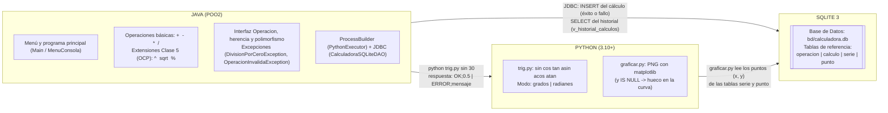
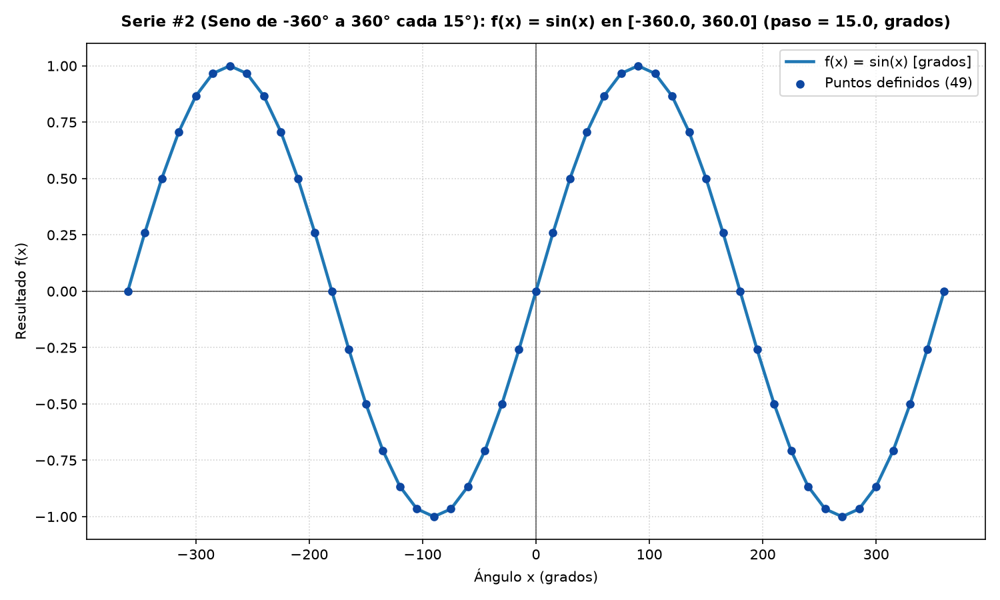
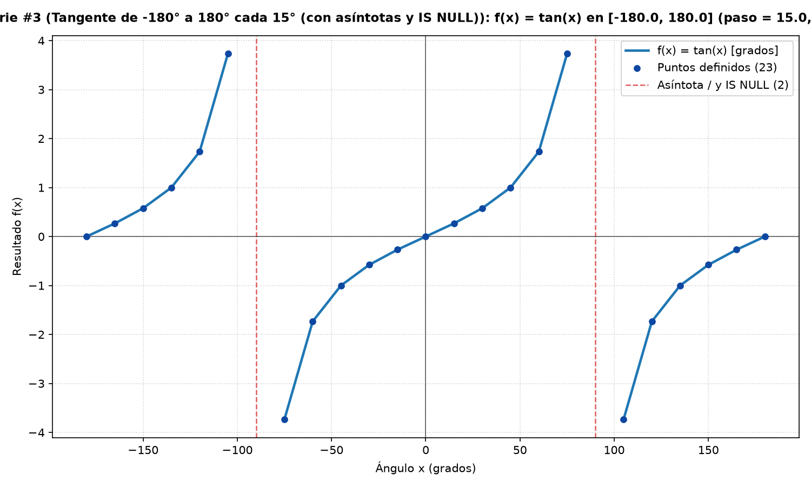
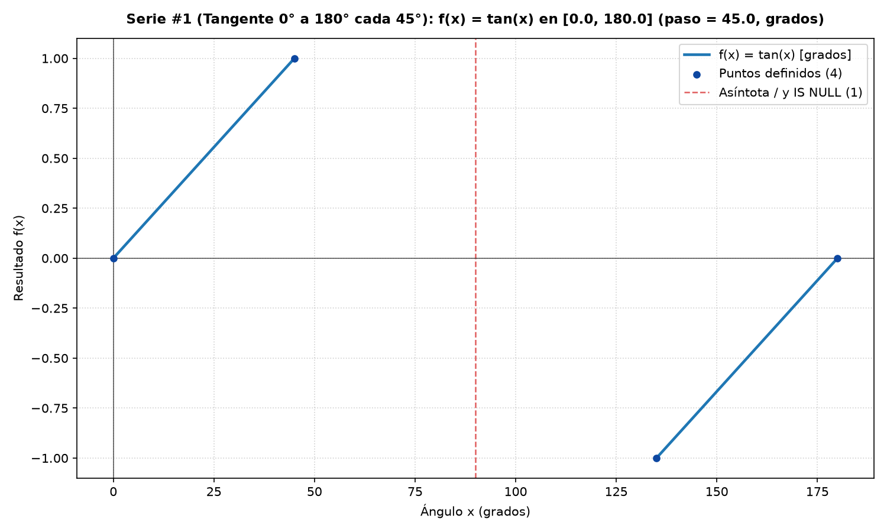

# 05. Arquitectura Java ⇄ Python ⇄ SQLite y Gráficas Generadas

[Volver a la Galería de Diagramas](./README.md)

---

## 1. Diagrama de Arquitectura y Contratos (Sección 2 del Enunciado Maestro)

| Flecha | Cómo se comunican | Qué viaja |
| :--- | :--- | :--- |
| **Java $\rightarrow$ Python** | Java arranca un proceso con `ProcessBuilder` y le pasa una `List<String>` de argumentos (seguro ante rutas con espacios en Windows). | `python trig.py sin 30` $\rightarrow$ una línea de respuesta: `OK;0.5` o `ERROR;mensaje` |
| **Java $\rightarrow$ SQLite** | JDBC con el controlador `sqlite-jdbc` y `PreparedStatement`. | `INSERT` del cálculo (éxito o fallo), `INSERT` transaccional de `serie`/`punto` y `SELECT` del historial |
| **Python $\rightarrow$ SQLite** | `graficar.py` abre `bd/calculadora.db` y lee los puntos `(x, y)` de la tabla `punto`. | Puntos `(x, y)` (con `y IS NULL` $\rightarrow$ `float('nan')`) $\rightarrow$ archivo PNG |

---

## 2. Gráficas Reales Generadas Leyendo de SQLite (`bd/calculadora.db`)

### 2.1. Curva de $\sin(x)$ de $-360^\circ$ a $360^\circ$ cada $15^\circ$ (49 puntos definidos)

### 2.2. Curva de $\tan(x)$ de $-180^\circ$ a $180^\circ$ cada $15^\circ$ (23 puntos definidos y 2 asíntotas `y IS NULL` en $-90^\circ$ y $90^\circ$)

### 2.3. Serie de Prueba Hito 1 (`pruebas.sql` — $\tan(x)$ de $0^\circ$ a $180^\circ$ cada $45^\circ$ con hueco en $90^\circ$)

