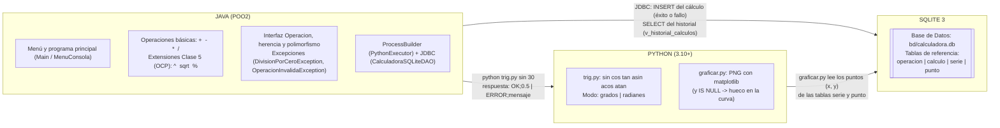
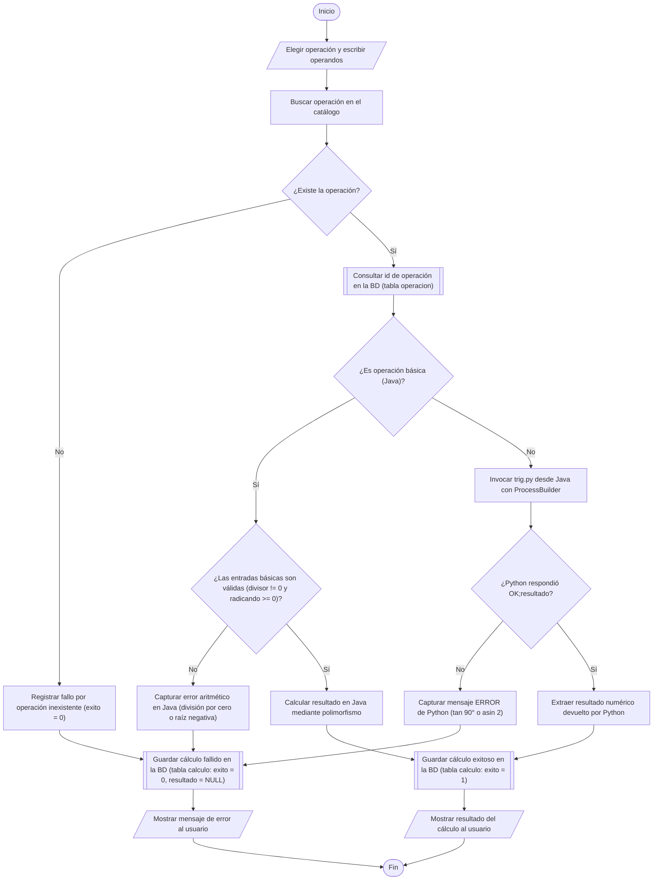
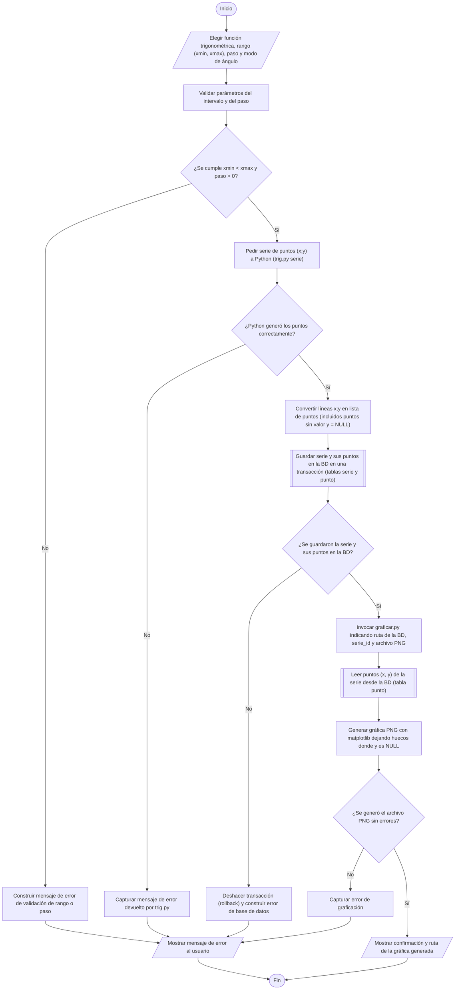
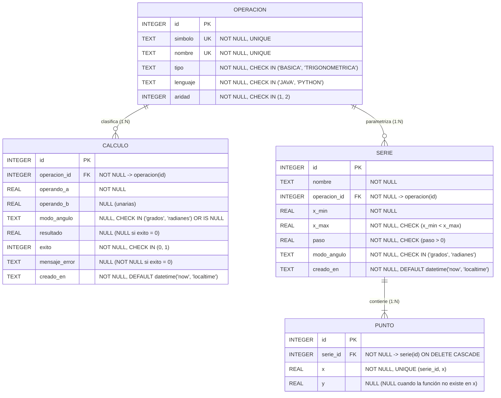
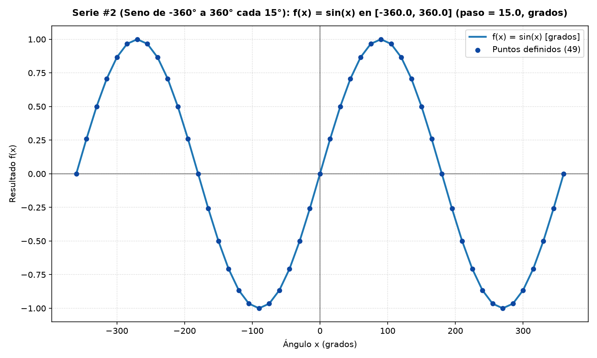
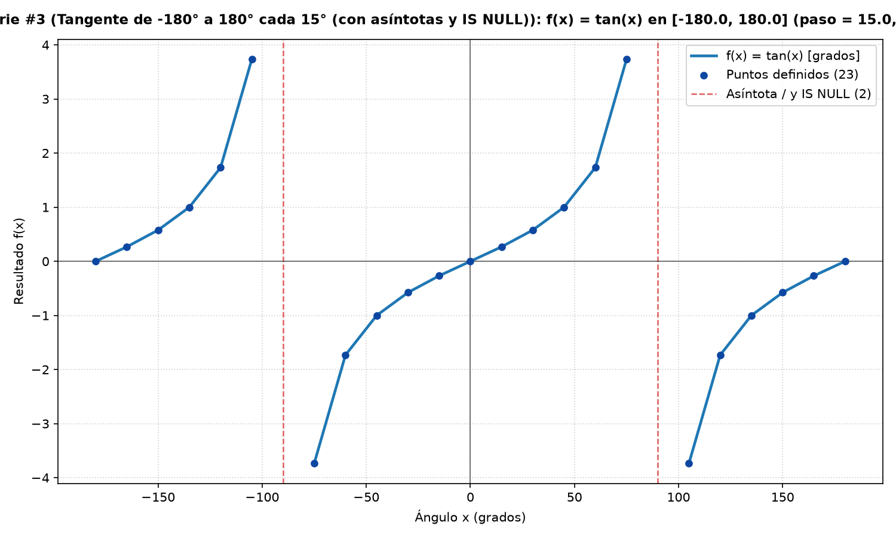

# Galería Oficial de Diagramas — La Calculadora (Java ⇄ Python ⇄ SQLite)

> **Asignaturas Integradas:** Bases de Datos & Programación Orientada a Objetos 2 (POO2) — **ESEIT (2026-2)**  
> **Docente:** Luis Fernando Vera Jaimes

Esta carpeta centraliza todos los diagramas normativos del proyecto para su inspección directa en GitHub:

| # | Archivo de Diagrama | Contenido Principal | Materia Líder |
| :-: | :--- | :--- | :--- |
| **01** | [01_Flujograma_1_Operacion_Completa.md](./01_Flujograma_1_Operacion_Completa.md) | Flujograma normativo de una operación completa (Java básica o Python trigonométrica), manejo de errores y persistencia en `calculo`. | Bases de Datos & POO2 |
| **02** | [02_Flujograma_2_Serie_y_Grafica.md](./02_Flujograma_2_Serie_y_Grafica.md) | Flujograma normativo de generación de serie de puntos `(x, y)`, guardado transaccional (`y = NULL`) y graficación con `matplotlib`. | Bases de Datos & POO2 |
| **03** | [03_Diagrama_ER_y_Modelo_Relacional_3FN.md](./03_Diagrama_ER_y_Modelo_Relacional_3FN.md) | Mapeo de Requisitos R1–R9, Diagrama Entidad-Relación (`erDiagram`), Modelo Relacional (`operacion`, `calculo`, `serie`, `punto`) y 3FN. | Bases de Datos |
| **04** | [04_Diagrama_Clases_UML_POO2.md](./04_Diagrama_Clases_UML_POO2.md) | Diagrama de Clases UML (`classDiagram`) con atributos, firmas completas de métodos, interfaz `Operacion`, herencia, polimorfismo, OCP, DAO y excepciones. | POO2 |
| **05** | [05_Arquitectura_y_Graficas_Matplotlib.md](./05_Arquitectura_y_Graficas_Matplotlib.md) | Diagrama de arquitectura de 3 capas (Java ⇄ Python ⇄ SQLite), contratos CLI y curvas PNG generadas desde SQLite. | Integración |

---

## Vista Rápida de todos los Diagramas

### A. Arquitectura General: Java ⇄ Python ⇄ SQLite (Sección 2 del Enunciado)

---

### B. Flujograma 1: La Operación Completa (Sección 4 del Enunciado)

> **Convención de Símbolos (Sección 4):** Óvalo `([...])` para Inicio/Fin, Paralelogramo `[/"..."/]` para Entrada/Salida, Rectángulo `["..."]` para Proceso (inicia con verbo y hace una sola cosa), Rombo `{"¿...?"}` para Decisión (dos salidas `Sí` y `No`), y **Rectángulo con barras laterales `[["..."]]` para la Base de Datos**.

---

### C. Flujograma 2: La Serie de Puntos y su Gráfica (Sección 4 del Enunciado)

---

### D. Diagrama Entidad-Relación (`erDiagram` — 4 Tablas Oficiales)

---

### E. Diagrama de Clases UML con Atributos y Firmas de Métodos (POO2)

```mermaid
classDiagram
    direction TB

    class Operacion {
        <<interface>>
        +getSimbolo() String
        +getNombre() String
        +getTipo() String
        +getLenguaje() String
        +getAridad() int
        +ejecutar(operandos: double...) double
    }

    class OperacionAbstracta {
        <<abstract>>
        -simbolo: String
        -nombre: String
        -tipo: String
        -lenguaje: String
        -aridad: int
        +getSimbolo() String
        +getNombre() String
        +getTipo() String
        +getLenguaje() String
        +getAridad() int
        #validarOperandos(operandos: double...) void
    }

    class OperacionBinaria {
        <<abstract>>
        +ejecutar(operandos: double...) double
        #calcularBinario(operandoA: double, operandoB: double)* double
    }

    class OperacionUnaria {
        <<abstract>>
        +ejecutar(operandos: double...) double
        #calcularUnario(operandoA: double)* double
    }

    class OperacionPython {
        -pythonExecutor: PythonExecutor
        -modoAngulo: String
        +getModoAngulo() String
        +setModoAngulo(modoAngulo: String) void
        #calcularUnario(operandoA: double) double
    }

    class Suma {
        #calcularBinario(operandoA: double, operandoB: double) double
    }
    class Resta {
        #calcularBinario(operandoA: double, operandoB: double) double
    }
    class Multiplicacion {
        #calcularBinario(operandoA: double, operandoB: double) double
    }
    class Division {
        #calcularBinario(operandoA: double, operandoB: double) double
    }
    class Potencia {
        #calcularBinario(base: double, exponente: double) double
    }
    class RaizCuadrada {
        #calcularUnario(operandoA: double) double
    }
    class Modulo {
        #calcularBinario(operandoA: double, operandoB: double) double
    }

    class PythonExecutor {
        -ejecutablePython: String
        -rutaTrigPy: Path
        -rutaGraficarPy: Path
        -directorioTrabajo: File
        +evaluarFuncionPuntual(funcion: String, valor: double, modoAngulo: String) double
        +generarSeriePuntos(funcion: String, xmin: double, xmax: double, paso: double, modoAngulo: String) List~PuntoSerie~
        +graficarSerieDesdeSQLite(rutaDb: Path, serieId: int, rutaSalidaPng: Path) String
    }

    class CalculadoraDAO {
        <<interface>>
        +obtenerIdOperacionPorSimbolo(simbolo: String) int
        +guardarCalculo(registro: RegistroCalculo) int
        +consultarHistorialReciente(limite: int) List~RegistroCalculo~
        +guardarSerieYPuntos(nombreSerie: String, operacionId: int, xMin: double, xMax: double, paso: double, modoAngulo: String, puntos: List~PuntoSerie~) int
        +consultarResumenSeries() List~SerieTrigonometrica~
        +consultarEstadisticasOperaciones() List~String~
    }

    class CalculadoraSQLiteDAO {
        -conexionSQLite: ConexionSQLite
    }

    class ConexionSQLite {
        -rutaBaseDatos: Path
        -urlJdbc: String
        +obtenerConexion() Connection
    }

    class MotorCalculadora {
        -catalogoPolimorfico: Map~String, Operacion~
        -dao: CalculadoraDAO
        -pythonExecutor: PythonExecutor
        -rutaBaseDatos: Path
        +registrarOperacion(operacion: Operacion) void
        +obtenerOperacion(simboloONombre: String) Operacion
        +ejecutarYPersistir(simboloOperacion: String, modoAngulo: String, operandos: double...) double
        +generarPersistirYGraficarSerie(nombreSerie: String, funcion: String, xMin: double, xMax: double, paso: double, modoAngulo: String, rutaSalidaPng: Path) String
    }

    class MenuConsola {
        -motor: MotorCalculadora
        -directorioBd: Path
        +iniciarMenuInteractivo() void
        +ejecutarDemostracionIntegral() void
    }

    class CalculadoraException {
        -codigoOperacion: String
        +getCodigoOperacion() String
    }
    class OperacionInvalidaException
    class DivisionPorCeroException
    class ProcesoPythonException
    class PersistenciaException

    Operacion <|.. OperacionAbstracta
    OperacionAbstracta <|-- OperacionBinaria
    OperacionAbstracta <|-- OperacionUnaria
    OperacionUnaria <|-- OperacionPython
    OperacionBinaria <|-- Suma
    OperacionBinaria <|-- Resta
    OperacionBinaria <|-- Multiplicacion
    OperacionBinaria <|-- Division
    OperacionBinaria <|-- Potencia
    OperacionBinaria <|-- Modulo
    OperacionUnaria <|-- RaizCuadrada
    OperacionPython --> PythonExecutor

    CalculadoraDAO <|.. CalculadoraSQLiteDAO
    CalculadoraSQLiteDAO --> ConexionSQLite

    CalculadoraException <|-- OperacionInvalidaException
    OperacionInvalidaException <|-- DivisionPorCeroException
    CalculadoraException <|-- ProcesoPythonException
    CalculadoraException <|-- PersistenciaException

    MotorCalculadora o-- Operacion
    MotorCalculadora --> CalculadoraDAO
    MotorCalculadora --> PythonExecutor
    MenuConsola --> MotorCalculadora
```

---

### F. Gráficas Generadas desde SQLite (`matplotlib`)

#### 1. Serie de $\sin(x)$ de $-360^\circ$ a $360^\circ$ cada $15^\circ$ (Requisito R5 y Clase 4)

#### 2. Serie de $\tan(x)$ de $-180^\circ$ a $180^\circ$ cada $15^\circ$ con huecos en asíntotas `y IS NULL` (Requisito R6)

