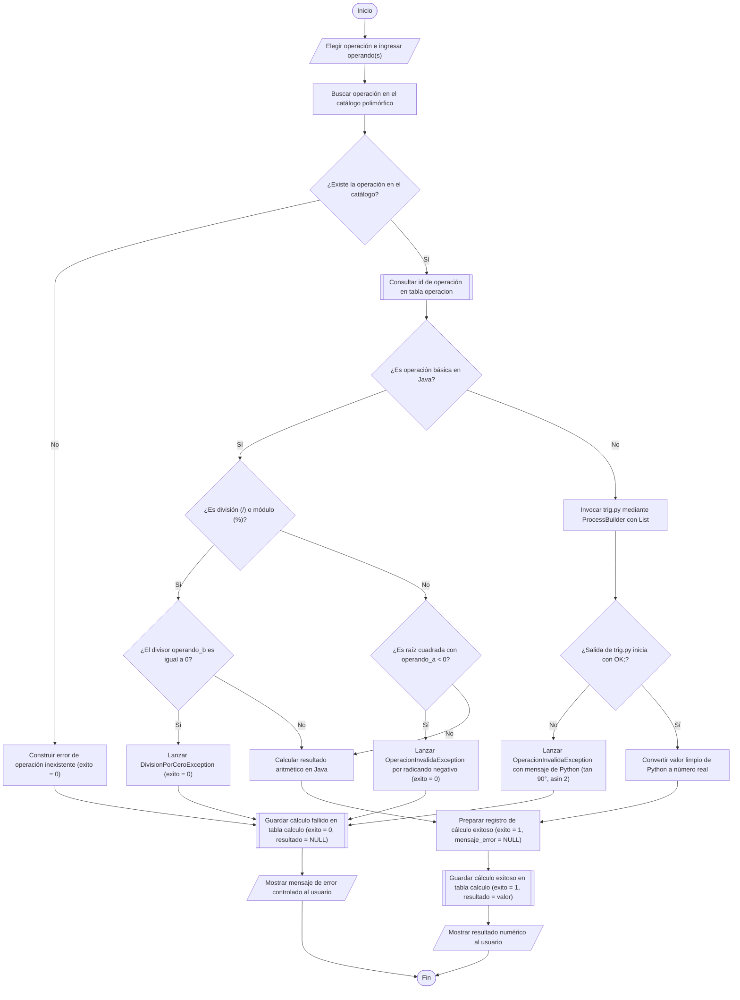
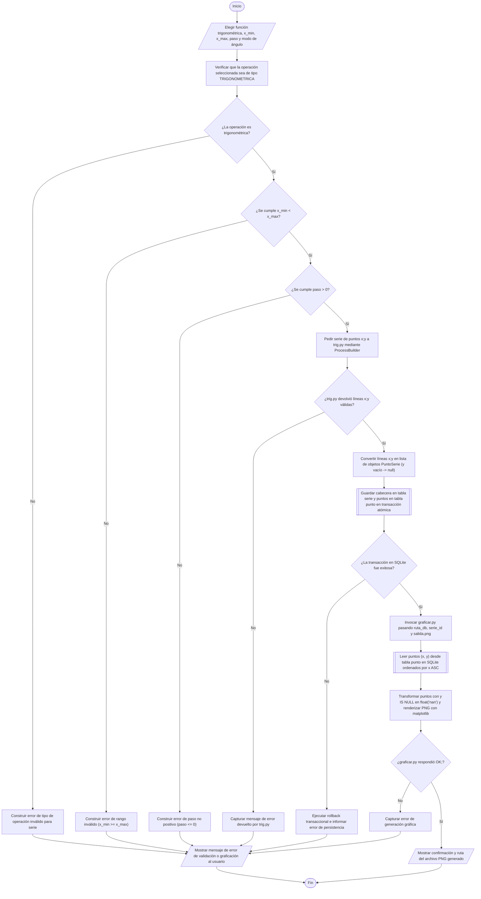
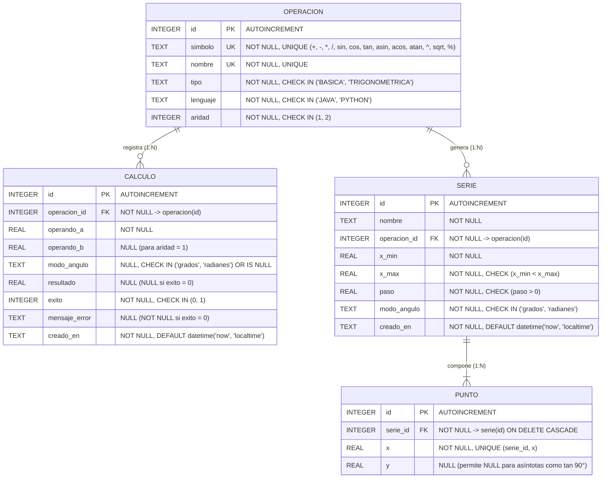

# Proyecto Integrado: "La Calculadora — Java, Python y SQLite"

| Dato | Detalle |
| :--- | :--- |
| **Institución** | Escuela Superior de Empresa, Ingeniería y Tecnología (ESEIT) |
| **Docente** | Luis Fernando Vera Jaimes |
| **Período** | 2026-2 |
| **Asignaturas** | Bases de Datos y Programación Orientada a Objetos 2 (POO2): un solo proyecto, dos materias |
| **Sistema Operativo** | Windows (verificado en Windows con Python 3.11, SQLite 3.45, Matplotlib 3.11 y OpenJDK 21) |
| **Galería de Diagramas** | Ver carpeta exclusiva [`../diagramas/`](../diagramas/README.md) |

---

## 1. Flujogramas Normativos y Guía de Símbolos para draw.io

### 1.1. Convención Normativa de Símbolos (Sección 4 del Enunciado Maestro)

| Símbolo Geométrico | Sintaxis en Mermaid | Forma en `draw.io` | Regla Normativa Aplicada |
| :--- | :--- | :--- | :--- |
| **Óvalo / Estadio** | `([Texto])` | *Terminator (Start / End)* | Exactamente **un solo `Inicio`** y al menos un `Fin`, donde terminan todos los caminos. |
| **Paralelogramo** | `[/"Texto"/]` | *Data (Input / Output)* | Entrada de datos del usuario o salida en pantalla/consola. |
| **Rectángulo** | `["Verbo ..."]` | *Process* | Inicia con **verbo** y ejecuta **una sola cosa**. |
| **Rombo** | `{"¿Pregunta?"}` | *Decision* | Pregunta cerrada con **exactamente dos salidas rotuladas `Sí` y `No`**. |
| **Rectángulo con barras laterales** | `[["Verbo ... en la BD"]]` | *Predefined Process / Database* | Operación de lectura o escritura en la base de datos SQLite (`bd/calculadora.db`). |

---

### 1.2. Flujograma 1: Ejecución de Operación Completa (Aritmética Java o Trigonométrica Python)



---

### 1.3. Flujograma 2: Generación de Serie de Puntos y su Gráfica



---

### 1.4. Tabla de Trazabilidad Estricta (Flujograma $\rightarrow$ Método UML $\rightarrow$ Tabla SQLite)

| Flujograma | Caja de Proceso / Decisión en el Flujograma | Clase y Método Exacto en el Diagrama de Clases UML | Entidad / Tabla en `bd/calculadora.db` |
| :---: | :--- | :--- | :--- |
| **Flujograma 1** | Elegir operación e ingresar operando(s) | `MenuConsola.flujoOperacionJava(scanner: Scanner, ...): void`<br>`MenuConsola.flujoOperacionTrigonometrica(scanner: Scanner): void` | *(Entrada por consola)* |
| **Flujograma 1** | Buscar operación en el catálogo polimórfico | `MotorCalculadora.obtenerOperacion(simboloONombre: String): Operacion` | `operacion` |
| **Flujograma 1** | Consultar id de operación en tabla `operacion` | `CalculadoraSQLiteDAO.obtenerIdOperacionPorSimbolo(simbolo: String): int` | `operacion (SELECT id)` |
| **Flujograma 1** | Calcular resultado aritmético en Java | `Operacion.ejecutar(operandos: double...): double`<br>`OperacionBinaria.calcularBinario(a: double, b: double): double`<br>`OperacionUnaria.calcularUnario(a: double): double` | *(Dominio Java)* |
| **Flujograma 1** | Lanzar `DivisionPorCeroException` / `OperacionInvalidaException` | `Division.calcularBinario(a: double, b: double): double`<br>`Modulo.calcularBinario(a: double, b: double): double`<br>`RaizCuadrada.calcularUnario(a: double): double` | `calculo (exito = 0)` |
| **Flujograma 1** | Invocar `trig.py` mediante `ProcessBuilder` con `List<String>` | `OperacionPython.calcularUnario(operandoA: double): double`<br>`PythonExecutor.evaluarFuncionPuntual(funcion: String, valor: double, modo: String): double` | *(Puente CLI Python)* |
| **Flujograma 1** | Guardar cálculo exitoso (`exito = 1`) o fallido (`exito = 0`) en BD | `MotorCalculadora.ejecutarYPersistir(simbolo: String, modo: String, operandos: double...): double`<br>`CalculadoraSQLiteDAO.guardarCalculo(registro: RegistroCalculo): int` | `calculo (INSERT)` |
| **Flujograma 2** | Elegir función, rango, paso y modo de ángulo | `MenuConsola.flujoSerieYGraficacion(scanner: Scanner): void` | *(Entrada por consola)* |
| **Flujograma 2** | Validar datos (`x_min < x_max`, `paso > 0`, tipo `TRIGONOMETRICA`) | `MotorCalculadora.generarPersistirYGraficarSerie(...): String` | `serie (CHECK x_min < x_max, paso > 0)` |
| **Flujograma 2** | Pedir serie de puntos `x;y` a `trig.py` | `PythonExecutor.generarSeriePuntos(funcion: String, xmin: double, xmax: double, paso: double, modo: String): List<PuntoSerie>` | *(Puente CLI Python)* |
| **Flujograma 2** | Guardar serie y puntos en BD (incluidos `y = NULL`) | `CalculadoraSQLiteDAO.guardarSerieYPuntos(nombre: String, operacionId: int, xMin: double, xMax: double, paso: double, modo: String, puntos: List<PuntoSerie>): int` | `serie (INSERT)`<br>`punto (INSERT Batch)` |
| **Flujograma 2** | Generar gráfica leyendo puntos de la BD | `PythonExecutor.graficarSerieDesdeSQLite(rutaDb: Path, serieId: int, rutaSalidaPng: Path): String`<br>`graficar.py -> graficar_serie(ruta_db, serie_id, ruta_salida)` | `serie (SELECT)`<br>`punto (SELECT x, y)` |

---

## 2. Diseño Completo de la Base de Datos Relacional

### 2.1. Matriz de Mapeo de Requisitos Oficiales (Sección 6: R1–R9 y G1–G6) $\rightarrow$ Entidades y Restricciones

| Código | Tema (Sección 6) | Requisito del Enunciado Maestro | Entidad / Componente Responsable | Implementación / Restricción Declarativa Exacta |
| :---: | :--- | :--- | :--- | :--- |
| **R1** | **Catálogo** | El sistema conoce las operaciones disponibles: símbolo, nombre, tipo (básica o trigonométrica), lenguaje de implementación (Java o Python) y cuántos operandos recibe. | Tabla `operacion` | `simbolo TEXT NOT NULL UNIQUE`, `nombre TEXT NOT NULL UNIQUE`, `CHECK (tipo IN ('BASICA', 'TRIGONOMETRICA'))`, `CHECK (lenguaje IN ('JAVA', 'PYTHON'))`, `CHECK (aridad IN (1, 2))` y `chk_operacion_coherencia_lenguaje` |
| **R2** | **Historial** | Cada cálculo queda guardado: qué operación, operandos, modo de ángulo (si aplica), resultado y momento. | Tabla `calculo` | `operacion_id FK`, `operando_a NOT NULL`, `operando_b NULL`, `modo_angulo NULL`, `resultado NULL`, `creado_en NOT NULL DEFAULT (datetime('now', 'localtime'))` |
| **R3** | **Fallos** | Los cálculos que fallan (división por cero, `tan 90°`, `asin 2`) también se guardan, con su mensaje de error y sin resultado. | Tabla `calculo` | Cuando `exito = 0`, `chk_calculo_coherencia_exito` exige `resultado IS NULL AND mensaje_error IS NOT NULL AND length(trim(mensaje_error)) > 0` |
| **R4** | **Modo de ángulo** | Las funciones trigonométricas trabajan en grados o en radianes; las operaciones básicas no llevan modo. | Tablas `calculo` y `serie` | En `calculo`: `CHECK (modo_angulo IN ('grados', 'radianes') OR modo_angulo IS NULL)` (`NULL` en básicas). En `serie`: `CHECK (modo_angulo IN ('grados', 'radianes'))` |
| **R5** | **Series** | Se pueden generar series de puntos `(x, y)` de una función en un rango y con un paso, por ejemplo `sin(x)` de `-360°` a `360°` cada `15°`. | Tablas `serie` y `punto` | `CONSTRAINT chk_serie_rango_valido CHECK (x_min < x_max)` y `CONSTRAINT chk_serie_paso_positivo CHECK (paso > 0)` |
| **R6** | **Puntos sin valor** | Hay puntos donde la función no existe (`tan 90°`): la serie debe poder representarlo. | Tabla `punto` y `graficar.py` | Columna `y REAL NULL` en `punto`; `graficar.py` transforma `None` en `float('nan')` dejando el hueco en la curva |
| **R7** | **Consultas** | El historial se consulta por operación, por éxito o fallo y en orden cronológico. | `v_historial_calculos` e Índices | Vista `v_historial_calculos`, consultas con `SELECT`, `JOIN`, `GROUP BY` e índices `idx_calculo_operacion`, `idx_calculo_exito`, `idx_calculo_creado_en` |
| **R8** | **Integridad** | La base rechaza datos incoherentes: tipos inválidos, cálculos de operaciones inexistentes, éxito sin resultado, etc. | Las 4 tablas | `PRAGMA foreign_keys = ON;` + `FOREIGN KEY`, `CHECK`, `UNIQUE` y `NOT NULL` verificados en `bd/pruebas.sql` |
| **R9** | **Extensibilidad** | Agregar una operación nueva (potencia, raíz o módulo) no debe obligar a cambiar la estructura de las tablas. | Tabla `operacion` y `Operacion` (Java) | Diseño en 3FN + Principio Abierto/Cerrado (OCP): nuevas operaciones son filas `INSERT` en `operacion` y subclases de `OperacionBinaria`/`OperacionUnaria` |
| **G1** | **Windows con espacios** | La calculadora funciona en Windows, también cuando la ruta de la carpeta contiene espacios. | `PythonExecutor` | `new ProcessBuilder(List<String>)` pasando cada argumento por separado y ejecutable Python configurable (`python` o `py`) |
| **G2** | **POO2 y OCP** | Las operaciones básicas se implementan en Java con interfaz común, herencia y polimorfismo; agregar `^`, `sqrt`, `%` no obliga a editar las existentes. | `calculadora.dominio` | `Operacion` $\leftarrow$ `OperacionAbstracta` $\leftarrow$ (`OperacionBinaria`, `OperacionUnaria`, `OperacionPython`) |
| **G3–G6** | **Errores y Pruebas** | División por cero, `tan 90°`, `asin 2` y operación inexistente se capturan, se guardan en `calculo` con `exito = 0` y existen pruebas con salida real. | `MotorCalculadora` y `CalculadoraSQLiteDAO` | Captura `CalculadoraException`, registra en `calculo` con `exito = 0`, `resultado = NULL` y `mensaje_error`, e informa sin abortar el programa |

---

### 2.2. Diagrama Entidad-Relación (Mermaid `erDiagram`)



**Explicación de Cardinalidades:**
1. **`OPERACION` $(1) \longrightarrow (0..N)$ `CALCULO`**: Una operación del catálogo puede ejecutarse cero, una o muchas veces a lo largo del tiempo en `calculo`; cada fila en `calculo` referencia obligatoriamente a una única `operacion` (`NOT NULL`).
2. **`OPERACION` $(1) \longrightarrow (0..N)$ `SERIE`**: Una operación trigonométrica del catálogo puede parametrizar cero o muchas series en `serie`; cada `serie` referencia obligatoriamente a una única `operacion` (`NOT NULL`).
3. **`SERIE` $(1) \longrightarrow (1..N)$ `PUNTO`**: Una serie trigonométrica está compuesta por múltiples puntos $(x, y)$ en `punto`; cada `punto` pertenece exclusivamente a una `serie` y se elimina en cascada (`ON DELETE CASCADE`) si su serie padre es eliminada.

---

### 2.3. Modelo Relacional Detallado

#### Tabla 1: `operacion`
| Columna | Tipo SQLite | Nulabilidad | Clave / Índice | Restricciones Declarativas (`CHECK` / `UNIQUE` / `DEFAULT`) |
| :--- | :--- | :--- | :--- | :--- |
| `id` | `INTEGER` | `NOT NULL` | `PRIMARY KEY` | `AUTOINCREMENT` |
| `simbolo` | `TEXT` | `NOT NULL` | `UNIQUE` | `CHECK (length(trim(simbolo)) > 0)` |
| `nombre` | `TEXT` | `NOT NULL` | `UNIQUE` | `CHECK (length(trim(nombre)) > 0)` |
| `tipo` | `TEXT` | `NOT NULL` | - | `CHECK (tipo IN ('BASICA', 'TRIGONOMETRICA'))` |
| `lenguaje` | `TEXT` | `NOT NULL` | - | `CHECK (lenguaje IN ('JAVA', 'PYTHON'))` |
| `aridad` | `INTEGER` | `NOT NULL` | - | `CHECK (aridad IN (1, 2))` + Coherencia: `(lenguaje = 'PYTHON' AND tipo = 'TRIGONOMETRICA' AND aridad = 1) OR (lenguaje = 'JAVA' AND tipo = 'BASICA' AND aridad IN (1, 2))` |

#### Tabla 2: `calculo`
| Columna | Tipo SQLite | Nulabilidad | Clave / Índice | Restricciones Declarativas (`CHECK` / `FK` / `DEFAULT`) |
| :--- | :--- | :--- | :--- | :--- |
| `id` | `INTEGER` | `NOT NULL` | `PRIMARY KEY` | `AUTOINCREMENT` |
| `operacion_id` | `INTEGER` | `NOT NULL` | `FOREIGN KEY`, `idx_calculo_operacion` | `REFERENCES operacion(id) ON UPDATE CASCADE ON DELETE RESTRICT` |
| `operando_a` | `REAL` | `NOT NULL` | - | Primer operando o ángulo/razón de entrada |
| `operando_b` | `REAL` | `NULL` | - | Segundo operando (`NULL` en operaciones unarias) |
| `modo_angulo` | `TEXT` | `NULL` | - | `CHECK (modo_angulo IN ('grados', 'radianes') OR modo_angulo IS NULL)` |
| `resultado` | `REAL` | `NULL` | - | `NOT NULL` cuando `exito = 1`; `NULL` cuando `exito = 0` |
| `exito` | `INTEGER` | `NOT NULL` | `idx_calculo_exito` | `CHECK (exito IN (0, 1))` |
| `mensaje_error` | `TEXT` | `NULL` | - | `NULL` cuando `exito = 1`; `NOT NULL` no vacío cuando `exito = 0` |
| `creado_en` | `TEXT` | `NOT NULL` | `idx_calculo_creado_en` | `DEFAULT (datetime('now', 'localtime'))` |

#### Tabla 3: `serie`
| Columna | Tipo SQLite | Nulabilidad | Clave / Índice | Restricciones Declarativas (`CHECK` / `FK` / `DEFAULT`) |
| :--- | :--- | :--- | :--- | :--- |
| `id` | `INTEGER` | `NOT NULL` | `PRIMARY KEY` | `AUTOINCREMENT` |
| `nombre` | `TEXT` | `NOT NULL` | - | `CHECK (length(trim(nombre)) > 0)` |
| `operacion_id` | `INTEGER` | `NOT NULL` | `FOREIGN KEY`, `idx_serie_operacion` | `REFERENCES operacion(id) ON UPDATE CASCADE ON DELETE RESTRICT` |
| `x_min` | `REAL` | `NOT NULL` | - | `CHECK (x_min < x_max)` |
| `x_max` | `REAL` | `NOT NULL` | - | `CHECK (x_min < x_max)` |
| `paso` | `REAL` | `NOT NULL` | - | `CHECK (paso > 0)` |
| `modo_angulo` | `TEXT` | `NOT NULL` | - | `CHECK (modo_angulo IN ('grados', 'radianes'))` |
| `creado_en` | `TEXT` | `NOT NULL` | - | `DEFAULT (datetime('now', 'localtime'))` |

#### Tabla 4: `punto`
| Columna | Tipo SQLite | Nulabilidad | Clave / Índice | Restricciones Declarativas (`UNIQUE` / `FK`) |
| :--- | :--- | :--- | :--- | :--- |
| `id` | `INTEGER` | `NOT NULL` | `PRIMARY KEY` | `AUTOINCREMENT` |
| `serie_id` | `INTEGER` | `NOT NULL` | `FOREIGN KEY`, `idx_punto_serie_x` | `REFERENCES serie(id) ON UPDATE CASCADE ON DELETE CASCADE` |
| `x` | `REAL` | `NOT NULL` | `UNIQUE(serie_id, x)` | Abscisa única dentro de la serie |
| `y` | `REAL` | `NULL` | - | Ordenada (`NULL` en asíntotas o fuera de dominio, R6) |

---

### 2.4. Justificación Formal de Normalización Paso a Paso (1FN, 2FN y 3FN) por Tabla

1. **Tabla `operacion`:**
   - **1FN:** Todos sus atributos (`simbolo`, `nombre`, `tipo`, `lenguaje`, `aridad`) contienen valores escalares atómicos sin listas ni grupos repetitivos.
   - **2FN:** Su clave primaria `id` (y sus claves candidatas `simbolo` y `nombre`) son simples (de una sola columna), por lo que no puede existir dependencia funcional parcial.
   - **3FN:** Ningún atributo no clave determina a otro atributo de forma irreductible ($\text{id} \rightarrow \text{simbolo}, \text{nombre}, \text{tipo}, \text{lenguaje}, \text{aridad}$).

2. **Tabla `calculo`:**
   - **1FN:** Cada operando (`operando_a`, `operando_b`) y el `resultado` se almacenan en columnas atómicas separadas, no como una cadena compuesta `"25.5 + 14.5 = 40"`.
   - **2FN:** La clave primaria `id` es simple; todos los atributos del evento de cálculo dependen completamente de `calculo.id`.
   - **3FN:** Se eliminaron de `calculo` los atributos descriptivos de la operación (`nombre`, `tipo`, `lenguaje`, `aridad`), que habrían generado la dependencia transitiva $\text{calculo.id} \rightarrow \text{operacion\_id} \rightarrow (\text{nombre}, \text{tipo}, \text{lenguaje}, \text{aridad})$. Solo se conserva la clave foránea `operacion_id`.

3. **Tabla `serie`:**
   - **1FN:** Los puntos $(x_i, y_i)$ generados por la serie no se guardan como un arreglo o texto separado por comas dentro de `serie`, sino en la tabla hija `punto`.
   - **2FN:** La clave primaria `serie.id` es simple y determina completamente `nombre`, `operacion_id`, `x_min`, `x_max`, `paso`, `modo_angulo` y `creado_en`.
   - **3FN:** Los metadatos de la función trigonométrica (`simbolo`, `nombre`, `lenguaje`) no se duplican en `serie`; se acceden vía `operacion_id -> operacion(id)`.

4. **Tabla `punto`:**
   - **1FN:** Cada par ordenado $(x, y)$ ocupa una fila individual con valores reales atómicos.
   - **2FN:** Considerando la clave candidata compuesta $(\text{serie\_id}, x)$, la ordenada $y$ depende de la combinación completa $(\text{serie\_id}, x)$ (el mismo valor de $x$ puede tener distintos valores de $y$ en distintas series). Los atributos que solo dependían de `serie_id` (`x_min`, `x_max`, `paso`, `modo_angulo`) fueron extraídos a la tabla `serie`.
   - **3FN:** No existe dependencia transitiva entre $x$ e $y$ dentro de `punto`, pues la relación funcional depende de la serie (`operacion_id` y `modo_angulo` en `serie`).

#### ¿Por qué agregar una operación nueva (ej. `^`, `sqrt`, `%`) es un `INSERT` y NO un `ALTER TABLE`?
En un mal diseño relacional (antipatrón de columnas por operación o `CHECK (simbolo IN ('+', '-', '*', '/'))` cableado en la tabla `calculo`), agregar la potencia (`^`), la raíz cuadrada (`sqrt`) o el módulo (`%`) obligaría a ejecutar un `ALTER TABLE` para añadir columnas (`resultado_potencia`, `resultado_raiz`) o reconstruir la tabla `calculo`.  
Gracias a que las operaciones están modeladas como **datos en la entidad catálogo `operacion`** (3FN) y referenciadas por clave foránea `operacion_id`, el esquema DDL permanece **cerrado a modificaciones estructurales (`ALTER TABLE`) y abierto a extensiones de catálogo mediante simples sentencias `INSERT INTO operacion`** en `bd/seed.sql`.

---

## 3. Evidencia de Ejecución Real en SQLite (`bd/create_schema.sql` y `bd/pruebas.sql`)

A continuación se presenta la salida real capturada en la terminal de Windows al ejecutar `python bd/sql.py bd/create_schema.sql`, `python bd/sql.py bd/seed.sql` y `python bd/sql.py bd/pruebas.sql` contra `bd/calculadora.db`:

```text
=== Ejecutando [create_schema.sql] sobre [D:\Users\Gabriel\OneDrive\Escritorio\calculadora\bd\calculadora.db] ===
[OK #1] PRAGMA foreign_keys = ON;
[OK #2] DROP VIEW IF EXISTS v_estadisticas_operacion;
[OK #3] DROP VIEW IF EXISTS v_resumen_series;
[OK #4] DROP VIEW IF EXISTS v_historial_calculos;
[OK #5] DROP VIEW IF EXISTS v_historial_detallado;
[OK #6] DROP TABLE IF EXISTS punto_serie;
[OK #7] DROP TABLE IF EXISTS serie_trig;
[OK #8] DROP TABLE IF EXISTS historial_calculo;
[OK #9] DROP TABLE IF EXISTS punto;
[OK #10] DROP TABLE IF EXISTS serie;
[OK #11] DROP TABLE IF EXISTS calculo;
[OK #12] DROP TABLE IF EXISTS operacion;
[OK #13] CREATE TABLE operacion (
[OK #14] CREATE TABLE calculo (
[OK #15] CREATE TABLE serie (
[OK #16] CREATE TABLE punto (
[OK #17] CREATE INDEX IF NOT EXISTS idx_calculo_operacion ON calculo(operacion_id);
[OK #18] CREATE INDEX IF NOT EXISTS idx_calculo_exito     ON calculo(exito);
[OK #19] CREATE INDEX IF NOT EXISTS idx_calculo_creado_en ON calculo(creado_en DESC);
[OK #20] CREATE INDEX IF NOT EXISTS idx_serie_operacion   ON serie(operacion_id);
[OK #21] CREATE INDEX IF NOT EXISTS idx_punto_serie_x     ON punto(serie_id, x);
=== Resumen [create_schema.sql]: 21 exitosa(s), 0 rechazo(s) de integridad, 0 error(es) inesperado(s) ===

=== Ejecutando [seed.sql] sobre [D:\Users\Gabriel\OneDrive\Escritorio\calculadora\bd\calculadora.db] ===
[OK #1] PRAGMA foreign_keys = ON;
[OK #2] INSERT OR IGNORE INTO operacion (id, simbolo, nombre, tipo, lenguaje, aridad) VALUES
[OK #3] INSERT OR IGNORE INTO operacion (id, simbolo, nombre, tipo, lenguaje, aridad) VALUES
=== Resumen [seed.sql]: 3 exitosa(s), 0 rechazo(s) de integridad, 0 error(es) inesperado(s) ===

=== Ejecutando [pruebas.sql] sobre [D:\Users\Gabriel\OneDrive\Escritorio\calculadora\bd\calculadora.db] ===
[OK #1] PRAGMA foreign_keys = ON;
[OK #2] INSERT INTO calculo (operacion_id, operando_a, operando_b, modo_angulo, resultado, exito, mensaje_error)
[OK #3] INSERT INTO calculo (operacion_id, operando_a, operando_b, modo_angulo, resultado, exito, mensaje_error)
[OK #4] INSERT INTO calculo (operacion_id, operando_a, operando_b, modo_angulo, resultado, exito, mensaje_error)
[OK #5] INSERT INTO calculo (operacion_id, operando_a, operando_b, modo_angulo, resultado, exito, mensaje_error)
[OK #6] INSERT INTO serie (id, nombre, operacion_id, x_min, x_max, paso, modo_angulo)
[OK #7] INSERT INTO punto (serie_id, x, y) VALUES
[RECHAZO ESPERADO #8] INSERT INTO calculo (operacion_id, operando_a, operando_b, modo_angulo, resultado, exito, mensaje_error)
   -> SQLite IntegrityError: CHECK constraint failed: chk_calculo_coherencia_exito
[RECHAZO ESPERADO #9] INSERT INTO serie (nombre, operacion_id, x_min, x_max, paso, modo_angulo)
   -> SQLite IntegrityError: CHECK constraint failed: chk_serie_rango_valido
[RECHAZO ESPERADO #10] INSERT INTO serie (nombre, operacion_id, x_min, x_max, paso, modo_angulo)
   -> SQLite IntegrityError: CHECK constraint failed: chk_serie_paso_positivo
[RECHAZO ESPERADO #11] INSERT INTO calculo (operacion_id, operando_a, operando_b, modo_angulo, resultado, exito, mensaje_error)
   -> SQLite IntegrityError: FOREIGN KEY constraint failed
[RECHAZO ESPERADO #12] INSERT INTO punto (serie_id, x, y)
   -> SQLite IntegrityError: UNIQUE constraint failed: punto.serie_id, punto.x
[RECHAZO ESPERADO #13] INSERT INTO operacion (simbolo, nombre, tipo, lenguaje, aridad)
   -> SQLite IntegrityError: CHECK constraint failed: chk_operacion_coherencia_lenguaje
=== Resumen [pruebas.sql]: 7 exitosa(s), 6 rechazo(s) de integridad, 0 error(es) inesperado(s) ===
```

---

## 4. Diagrama de Clases UML Completo (POO2)

El diseño en Java (`src/calculadora/`) implementa la interfaz común `Operacion`, la jerarquía de clases abstractas intermedias (`OperacionAbstracta`, `OperacionBinaria`, `OperacionUnaria`, `OperacionPython`), las clases concretas de las Clases 2 y 5, el puente `PythonExecutor`, el patrón DAO con JDBC (`ConexionSQLite`, `CalculadoraDAO`, `CalculadoraSQLiteDAO`) y la jerarquía de excepciones personalizadas (`CalculadoraException`, `OperacionInvalidaException`, `DivisionPorCeroException`, `ProcesoPythonException`, `PersistenciaException`).

```mermaid
classDiagram
    direction TB

    class Operacion {
        <<interface>>
        +getSimbolo() String
        +getNombre() String
        +getTipo() String
        +getLenguaje() String
        +getAridad() int
        +ejecutar(operandos: double...) double
    }

    class OperacionAbstracta {
        <<abstract>>
        -simbolo: String
        -nombre: String
        -tipo: String
        -lenguaje: String
        -aridad: int
        #OperacionAbstracta(simbolo: String, nombre: String, tipo: String, lenguaje: String, aridad: int)
        +getSimbolo() String
        +getNombre() String
        +getTipo() String
        +getLenguaje() String
        +getAridad() int
        #validarOperandos(operandos: double...) void
    }

    class OperacionBinaria {
        <<abstract>>
        #OperacionBinaria(simbolo: String, nombre: String)
        +ejecutar(operandos: double...) double
        #calcularBinario(operandoA: double, operandoB: double)* double
    }

    class OperacionUnaria {
        <<abstract>>
        #OperacionUnaria(simbolo: String, nombre: String, tipo: String, lenguaje: String)
        +ejecutar(operandos: double...) double
        #calcularUnario(operandoA: double)* double
    }

    class OperacionPython {
        -pythonExecutor: PythonExecutor
        -modoAngulo: String
        +OperacionPython(simbolo: String, nombre: String, pythonExecutor: PythonExecutor, modoPorDefecto: String)
        +getModoAngulo() String
        +setModoAngulo(modoAngulo: String) void
        #calcularUnario(operandoA: double) double
    }

    class Suma {
        +Suma()
        #calcularBinario(operandoA: double, operandoB: double) double
    }

    class Resta {
        +Resta()
        #calcularBinario(operandoA: double, operandoB: double) double
    }

    class Multiplicacion {
        +Multiplicacion()
        #calcularBinario(operandoA: double, operandoB: double) double
    }

    class Division {
        -EPSILON: double
        +Division()
        #calcularBinario(operandoA: double, operandoB: double) double
    }

    class Potencia {
        +Potencia()
        #calcularBinario(base: double, exponente: double) double
    }

    class RaizCuadrada {
        +RaizCuadrada()
        #calcularUnario(operandoA: double) double
    }

    class Modulo {
        -EPSILON: double
        +Modulo()
        #calcularBinario(operandoA: double, operandoB: double) double
    }

    class PythonExecutor {
        -ejecutablePython: String
        -rutaTrigPy: Path
        -rutaGraficarPy: Path
        -directorioTrabajo: File
        +PythonExecutor(ejecutablePython: String, rutaTrigPy: Path, rutaGraficarPy: Path, directorioTrabajo: File)
        +getEjecutablePython() String
        +setEjecutablePython(ejecutablePython: String) void
        +evaluarFuncionPuntual(funcion: String, valor: double, modoAngulo: String) double
        +generarSeriePuntos(funcion: String, xmin: double, xmax: double, paso: double, modoAngulo: String) List~PuntoSerie~
        +graficarSerieDesdeSQLite(rutaDb: Path, serieId: int, rutaSalidaPng: Path) String
        -ejecutarSubproceso(comando: List~String~, simboloOp: String) List~String~
    }

    class ConexionSQLite {
        -rutaBaseDatos: Path
        -urlJdbc: String
        +ConexionSQLite(rutaBaseDatos: Path)
        +obtenerConexion() Connection
        +getRutaBaseDatos() Path
    }

    class CalculadoraDAO {
        <<interface>>
        +obtenerIdOperacionPorSimbolo(simbolo: String) int
        +guardarCalculo(registro: RegistroCalculo) int
        +consultarHistorialReciente(limite: int) List~RegistroCalculo~
        +guardarSerieYPuntos(nombreSerie: String, operacionId: int, xMin: double, xMax: double, paso: double, modoAngulo: String, puntos: List~PuntoSerie~) int
        +consultarResumenSeries() List~SerieTrigonometrica~
        +consultarEstadisticasOperaciones() List~String~
    }

    class CalculadoraSQLiteDAO {
        -conexionSQLite: ConexionSQLite
        +CalculadoraSQLiteDAO(conexionSQLite: ConexionSQLite)
        +obtenerIdOperacionPorSimbolo(simbolo: String) int
        +guardarCalculo(registro: RegistroCalculo) int
        +consultarHistorialReciente(limite: int) List~RegistroCalculo~
        +guardarSerieYPuntos(nombreSerie: String, operacionId: int, xMin: double, xMax: double, paso: double, modoAngulo: String, puntos: List~PuntoSerie~) int
        +consultarResumenSeries() List~SerieTrigonometrica~
        +consultarEstadisticasOperaciones() List~String~
    }

    class RegistroCalculo {
        -id: Integer
        -operacionId: int
        -simbolo: String
        -nombreOperacion: String
        -tipo: String
        -lenguaje: String
        -operandoA: double
        -operandoB: Double
        -modoAngulo: String
        -resultado: Double
        -exito: int
        -mensajeError: String
        -creadoEn: String
        +exitoso(operacionId: int, simbolo: String, operandoA: double, operandoB: Double, modoAngulo: String, resultado: double)$ RegistroCalculo
        +fallido(operacionId: int, simbolo: String, operandoA: double, operandoB: Double, modoAngulo: String, mensajeError: String)$ RegistroCalculo
    }

    class PuntoSerie {
        -id: Integer
        -serieId: Integer
        -x: double
        -y: Double
        +PuntoSerie(x: double, y: Double)
        +getX() double
        +getY() Double
        +esDiscontinuidad() boolean
    }

    class SerieTrigonometrica {
        -id: Integer
        -nombre: String
        -operacionId: int
        -funcion: String
        -xMin: double
        -xMax: double
        -paso: double
        -modoAngulo: String
        -creadoEn: String
        -totalPuntos: int
        -puntosDefinidos: int
        -puntosNulosAsintotas: int
    }

    class CalculadoraException {
        -codigoOperacion: String
        +CalculadoraException(mensaje: String)
        +CalculadoraException(codigoOperacion: String, mensaje: String)
        +CalculadoraException(codigoOperacion: String, mensaje: String, causa: Throwable)
        +getCodigoOperacion() String
    }

    class OperacionInvalidaException {
        +OperacionInvalidaException(simboloOperacion: String, mensaje: String)
        +OperacionInvalidaException(mensaje: String)
    }

    class DivisionPorCeroException {
        +DivisionPorCeroException(simboloOperacion: String, mensaje: String)
    }

    class ProcesoPythonException {
        +ProcesoPythonException(codigoOperacion: String, mensaje: String)
        +ProcesoPythonException(codigoOperacion: String, mensaje: String, causa: Throwable)
    }

    class PersistenciaException {
        +PersistenciaException(mensaje: String)
        +PersistenciaException(mensaje: String, causa: Throwable)
    }

    class MotorCalculadora {
        -catalogoPolimorfico: Map~String, Operacion~
        -dao: CalculadoraDAO
        -pythonExecutor: PythonExecutor
        -rutaBaseDatos: Path
        +MotorCalculadora(dao: CalculadoraDAO, pythonExecutor: PythonExecutor, rutaBaseDatos: Path)
        +registrarOperacion(operacion: Operacion) void
        +obtenerOperacion(simboloONombre: String) Operacion
        +listarOperacionesRegistradas() Collection~Operacion~
        +ejecutarYPersistir(simboloOperacion: String, modoAngulo: String, operandos: double...) double
        +generarPersistirYGraficarSerie(nombreSerie: String, funcion: String, xMin: double, xMax: double, paso: double, modoAngulo: String, rutaSalidaPng: Path) String
        +obtenerHistorialReciente(limite: int) List~RegistroCalculo~
        +obtenerResumenSeries() List~SerieTrigonometrica~
        +obtenerEstadisticasOperaciones() List~String~
    }

    class MenuConsola {
        -motor: MotorCalculadora
        -directorioBd: Path
        +MenuConsola(motor: MotorCalculadora, directorioBd: Path)
        +iniciarMenuInteractivo() void
        +ejecutarDemostracionIntegral() void
        +mostrarHistorialReciente(limite: int) void
        +mostrarSeriesYEstadisticas() void
    }

    Operacion <|.. OperacionAbstracta
    OperacionAbstracta <|-- OperacionBinaria
    OperacionAbstracta <|-- OperacionUnaria
    OperacionUnaria <|-- OperacionPython
    OperacionBinaria <|-- Suma
    OperacionBinaria <|-- Resta
    OperacionBinaria <|-- Multiplicacion
    OperacionBinaria <|-- Division
    OperacionBinaria <|-- Potencia
    OperacionBinaria <|-- Modulo
    OperacionUnaria <|-- RaizCuadrada
    OperacionPython --> PythonExecutor : delega CLI

    CalculadoraDAO <|.. CalculadoraSQLiteDAO
    CalculadoraSQLiteDAO --> ConexionSQLite : usa JDBC

    CalculadoraException <|-- OperacionInvalidaException
    OperacionInvalidaException <|-- DivisionPorCeroException
    CalculadoraException <|-- ProcesoPythonException
    CalculadoraException <|-- PersistenciaException

    MotorCalculadora o-- Operacion : polimorfismo OCP
    MotorCalculadora --> CalculadoraDAO : persiste
    MotorCalculadora --> PythonExecutor : series y gráficas
    MenuConsola --> MotorCalculadora : coordina
```



---

## 5. Bitácora Oficial de Uso de Inteligencia Artificial

| Fecha / clase | Herramienta | Qué pedimos (resumen) | Qué aceptamos y qué cambiamos | Cómo lo verificamos |
| :--- | :--- | :--- | :--- | :--- |
| **Clase 1 (Hito 1 — Flujogramas y Modelo E-R / 3FN)** | Asistente IA (Gemini) | Generar los 2 flujogramas normativos (Operación completa y Serie/Gráfica) y el diseño de las 4 tablas (`operacion`, `calculo`, `serie`, `punto`) en 3FN con restricciones R1–R9. | **Aceptamos:** La separación en 4 entidades y las relaciones `1:N`.<br>**Cambiamos:** En los flujogramas aseguramos un único `Inicio`, verbos imperativos en procesos y rombos con salidas exclusivas `Sí`/`No`. En `operacion` añadimos el `CHECK` cruzado que obliga a `lenguaje='PYTHON' => tipo='TRIGONOMETRICA' AND aridad=1`, y en `calculo` el `CHECK` que vincula `exito=1` con `resultado IS NOT NULL AND mensaje_error IS NULL`. | Ejecutamos `python bd/sql.py bd/create_schema.sql` y `python bd/sql.py bd/pruebas.sql` verificando que las 5 pruebas acepten los casos válidos y rechacen las violaciones de `CHECK`, `FOREIGN KEY` y `UNIQUE`. |
| **Clase 2 (Catálogo Semilla y Consultas SQL)** | Asistente IA (Gemini) | Crear `bd/seed.sql` con las 10 operaciones iniciales y `bd/consultas.sql` con `v_historial_calculos`, `JOIN`, `GROUP BY` e índices. | **Aceptamos:** Las sentencias `INSERT OR IGNORE` para el catálogo y la estructura de `v_historial_calculos`.<br>**Cambiamos:** Agregamos la columna calculada `expresion` en la vista para formatear tanto operaciones unarias como binarias, y creamos `v_resumen_series` usando `COUNT(p.id) - COUNT(p.y)` para contar exactamente las asíntotas (`y IS NULL`). | Ejecutamos `python bd/sql.py bd/consultas.sql` sobre `bd/calculadora.db` y comprobamos las tablas ASCII devueltas en la terminal. |
| **Clase 3 (Motor Python `trig.py` y `graficar.py`)** | Asistente IA (Gemini) | Implementar `python/trig.py` (puntual y serie) y `python/graficar.py` leyendo de SQLite con `matplotlib`. | **Aceptamos:** El cálculo trigonométrico en grados/radianes y el uso del backend `Agg` en `matplotlib`.<br>**Cambiamos:** 1) Aplicamos el umbral `abs(valor) < 1e-12 -> 0.0` para eliminar el ruido IEEE 754 en `sin(180°)`. 2) Reemplazamos `argparse` en los operandos numéricos por un parser propio para que valores negativos como `-360` o `-0.5` no sean rechazados como flags. 3) En `graficar.py` convertimos `y IS NULL` (`None`) en `float('nan')` en lugar de filtrarlo en SQL, logrando huecos reales en las asíntotas. | Probamos en PowerShell `python python/trig.py sin 180`, `python python/trig.py tan 90`, `python python/trig.py asin 2`, `python python/trig.py serie sin -360 360 15` y verificamos los archivos PNG generados. |
| **Clase 4 (Dominio POO2, `PythonExecutor` y DAO JDBC)** | Asistente IA (Gemini) | Construir la jerarquía polimórfica `Operacion`, el puente `ProcessBuilder` y `CalculadoraSQLiteDAO` con transacciones. | **Aceptamos:** El patrón Template Method en `OperacionBinaria` / `OperacionUnaria` y el uso de `PreparedStatement`.<br>**Cambiamos:** 1) En `PythonExecutor` pasamos cada argumento en `List<String>` (`rutaTrigPy.toAbsolutePath().toString()`) sin concatenar cadenas para soportar carpetas con espacios en Windows (G1). 2) En `guardarSerieYPuntos` implementamos `setAutoCommit(false)`, `addBatch()`, `executeBatch()`, `commit()` y `rollback()`. | Compilamos con `javac -encoding UTF-8 -cp "lib\*" -d out ...` y ejecutamos en una ruta de OneDrive/Escritorio verificando la persistencia en `bd/calculadora.db`. |
| **Clases 5 y 6 (Extensiones OCP `^`, `sqrt`, `%` y Pruebas E2E)** | Asistente IA (Gemini) | Incorporar `Potencia`, `RaizCuadrada` y `Modulo` cumpliendo OCP y validar el manejo de errores G3–G6. | **Aceptamos:** Las clases `Potencia`, `RaizCuadrada` y `Modulo` heredando de `OperacionBinaria` y `OperacionUnaria`.<br>**Cambiamos:** Verificamos que `MotorCalculadora.ejecutarYPersistir` no requirió ningún cambio para ejecutar las 3 nuevas operaciones y que ante una operación inexistente (`log_inexistente`) captura `OperacionInvalidaException` y persiste el fallo con `exito = 0` en `calculo`. | Ejecutamos `java "-Dfile.encoding=UTF-8" -cp "out;lib\*" calculadora.Main --demo` comprobando las 20 filas en `calculo` y las gráficas `sin_-360_360_paso15.png` y `tan_-180_180_paso15.png`. |
